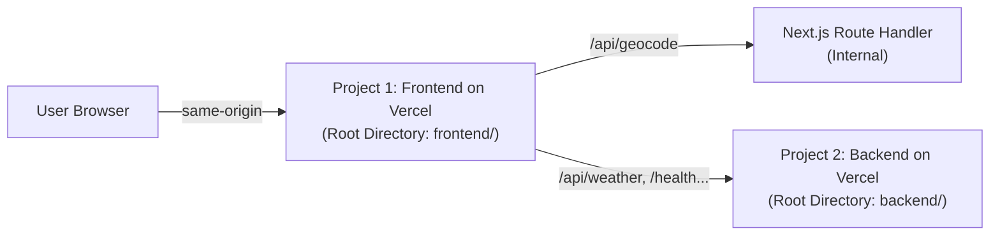

# Deployment Guide: ClimateScope (Two Vercel Projects)

This repository is configured to deploy as **Two Independent Projects on Vercel** from the same GitHub repository:
1. **Project 1 — Frontend**: Next.js 16 (React 19, Tailwind CSS v4, Leaflet maps, Recharts).
2. **Project 2 — Backend**: FastAPI Python application using Vercel's official Python Serverless runtime.



---

## 1. Project 2 — Backend Deployment (Deploy First)

Deploy the backend first so you have its production URL ready for the frontend.

### Vercel Dashboard Settings:
1. Go to **[vercel.com/new](https://vercel.com/new)** and import `mobin-25/CodeStorm-Climate-Intelligence`.
2. **Project Name**: `climatescope-backend` *(or your preference)*.
3. **Root Directory**: Click **Edit** and select **`backend`**.
4. **Framework Preset**: Auto-detected as **Other / Python**.
5. **Build and Output Settings**: Leave as default.

### Environment Variables for Project 2:
Add under **Project Settings ➔ Environment Variables**:

| Variable | Value | Purpose |
| :--- | :--- | :--- |
| `ARCHIVE_REQUEST_TIMEOUT_SECONDS` | `10.0` | Server-side timeout guard protecting against upstream Open-Meteo latency under Vercel Hobby execution limits |
| `HISTORICAL_REQUEST_TIMEOUT_SECONDS` | `10.0` | Upstream provider timeout guard |
| `CPCB_API_KEY` | *(Optional secret)* | Secret key for CPCB / CAAQMS data feeds. Kept strictly server-side |

### Click Deploy
Vercel packages [`backend/index.py`](./backend/index.py) using dependencies from [`backend/requirements.txt`](./backend/requirements.txt).
Once deployed, copy your backend URL:
`https://climatescope-backend.vercel.app` (or your assigned domain).

---

## 2. Project 1 — Frontend Deployment (Deploy Second)

### Vercel Dashboard Settings:
1. Go to **[vercel.com/new](https://vercel.com/new)** and import the same repository `mobin-25/CodeStorm-Climate-Intelligence`.
2. **Project Name**: `climatescope-frontend` *(or your preference)*.
3. **Root Directory**: Click **Edit** and select **`frontend`**.
4. **Framework Preset**: Auto-detected as **Next.js** (zero configuration mismatch).
5. **Build and Output Settings**: Leave as default (`next build`, `.next`).

### Environment Variables for Project 1:
Add under **Project Settings ➔ Environment Variables**:

| Variable | Value | Purpose |
| :--- | :--- | :--- |
| `BACKEND_URL` | `https://climatescope-backend.vercel.app` | URL of your deployed Project 2 backend. Next.js server-side rewrites proxy API calls to this address |
| `NEXT_PUBLIC_USE_REAL_BACKEND` | `true` | Instructs the UI to fetch live data from the backend rather than using fallback sample corridors |

### Click Deploy
Vercel compiles the Next.js frontend with Turbopack and static generation.
Once deployed, your live application will be available at:
`https://climatescope-frontend.vercel.app`

---

## 3. How API Routing Works

All browser traffic stays **strictly same-origin** on the frontend domain:

| Request URL from Browser | Handler | Execution Type |
| :--- | :--- | :--- |
| `GET /` | Next.js Page | Static / Edge |
| `GET /compare` | Next.js Page | Static / Client |
| `GET /insights` | Next.js Page | Static / Client |
| `GET /reports` | Next.js Page | Static / Client |
| `GET /api/geocode?q=...` | Next.js Route Handler ([`frontend/app/api/geocode/route.ts`](./frontend/app/api/geocode/route.ts)) | Handled directly by Frontend (never sent to Backend) |
| `GET /health` | Next.js Rewrite ➔ Backend (`/health`) | Proxied server-side to Project 2 |
| `GET /api/weather/*` | Next.js Rewrite ➔ Backend (`/api/weather/*`) | Proxied server-side to Project 2 |
| `GET /api/air-quality/*` | Next.js Rewrite ➔ Backend (`/api/air-quality/*`) | Proxied server-side to Project 2 |
| `GET /api/climate-risk/*` | Next.js Rewrite ➔ Backend (`/api/climate-risk/*`) | Proxied server-side to Project 2 |
| `GET /api/historical/*` | Next.js Rewrite ➔ Backend (`/api/historical/*`) | Proxied server-side to Project 2 |
| `GET /api/forecast/*` | Next.js Rewrite ➔ Backend (`/api/forecast/*`) | Proxied server-side to Project 2 |

---

## 4. Local Development

Running locally is unchanged:

### Terminal 1 — Backend (FastAPI):
```bash
cd backend
python -m venv .venv
source .venv/bin/activate  # On Windows: .venv\Scripts\activate
pip install -r requirements.txt
uvicorn app.main:app --reload --port 8000
```

### Terminal 2 — Frontend (Next.js):
```bash
cd frontend
npm install
npm run dev
```

Next.js rewrites automatically route `/api/weather/*` etc. to `http://localhost:8000` when `BACKEND_URL` is omitted.
